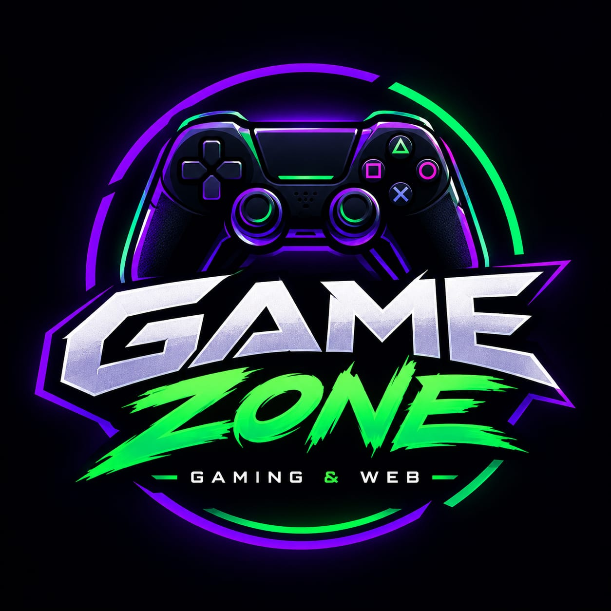
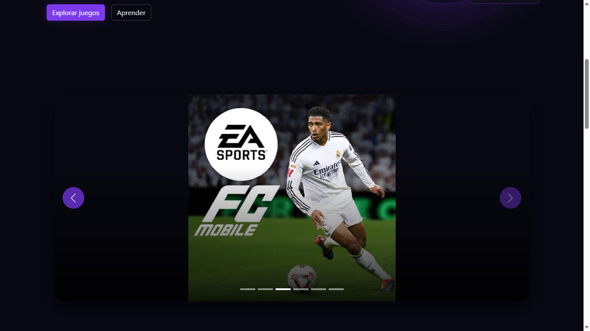
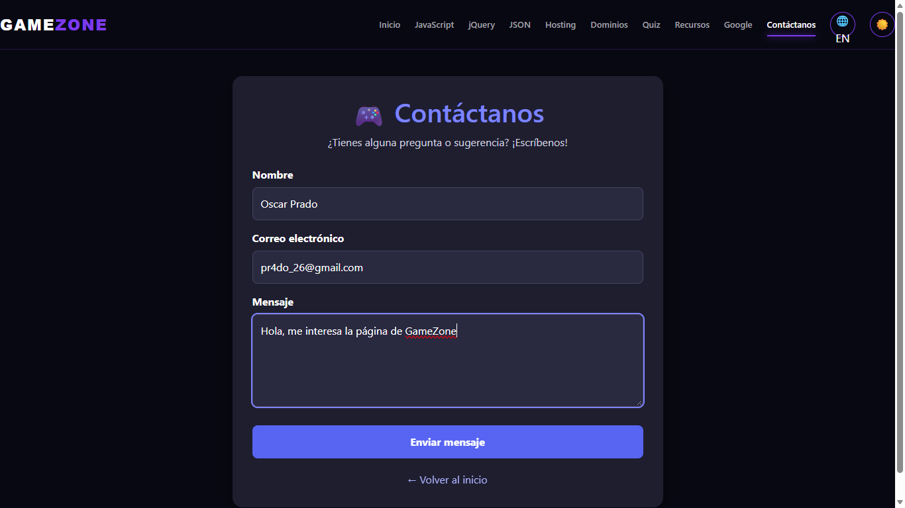
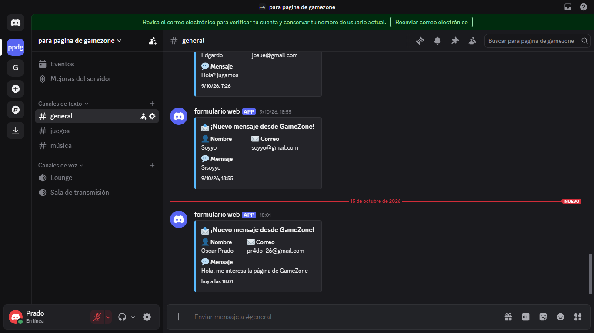
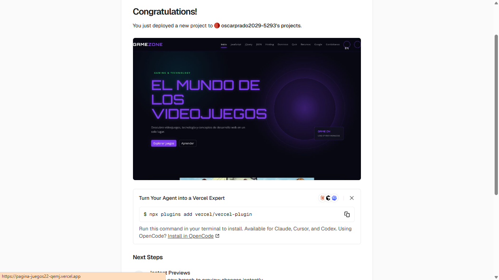
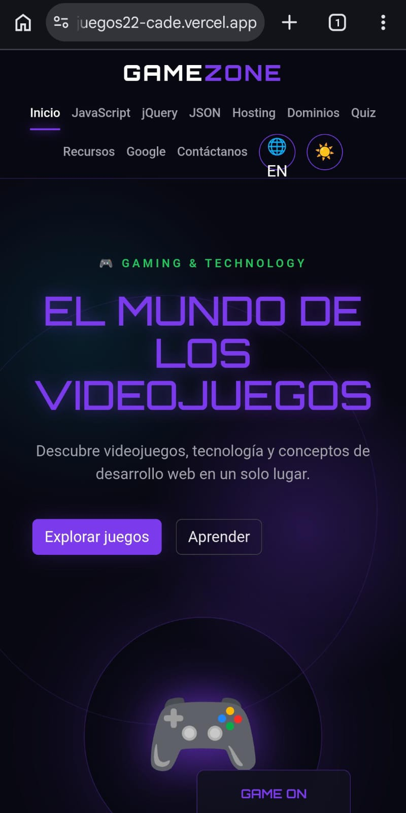
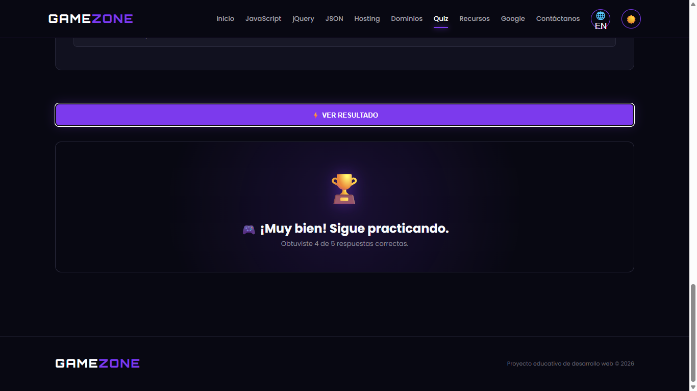

🚀 Portafolio de Proyecto Web: GameZone | Gaming & Web

Estudiante: (Oscar Leonel Menjivar Prado).
Fecha: (Viernes 16/10/2026).
Enlace al Sitio Web (Vercel): (Aquí pega el enlace de tu página publicada en Vercel).
Repositorio GitHub: https://github.com/prado2029-png/Pagina-Gamezone

---

1. Identidad de Marca y Producto

📦 Ficha del Producto

- Nombre Comercial: GameZone.
- Descripción: GameZone es un sitio web interactivo dedicado al mundo de los videojuegos y al aprendizaje de conceptos relacionados con el desarrollo web. Presenta videojuegos, información educativa y herramientas interactivas.
- Público Objetivo: Personas interesadas en los videojuegos, la tecnología y el desarrollo web.
- Propuesta de Valor: Reunir contenido sobre videojuegos e información educativa de tecnologías web en un sitio visual, organizado e interactivo.

🎨 Diseño Visual
### Logotipo

Paleta de Colores:

Color| Código HEX| Uso en el sitio
Dominante| "#080812"| Fondo principal y secciones oscuras
Secundario| "#7C3AED"| Botones y elementos destacados
Acento| "#22C55E"| Detalles y elementos interactivos
Texto| "#FFFFFF"| Textos y elementos claros

La combinación de estos colores busca ofrecer una apariencia moderna relacionada con el mundo de los videojuegos. La página utiliza las tipografías Orbitron y Poppins.

Demostración del Carrusel (Bootstrap):

El carrusel de la página principal presenta imágenes de diferentes videojuegos, como GTA V, Minecraft, EA Sports FC, Free Fire, Bus Simulator y eFootball.

### Evidencia del carrusel

---

2. Investigación Técnica

Resumen informativo de los temas investigados en el proyecto.

1. JavaScript (Vanilla)

JavaScript es un lenguaje de programación que permite agregar interactividad a las páginas web. HTML organiza el contenido, CSS controla la apariencia y JavaScript permite responder a las acciones del usuario.

Entre sus conceptos principales están las variables, que almacenan información; las funciones, que agrupan instrucciones; y los eventos, que permiten responder a acciones como pulsar un botón.

Ejemplo:

function mostrarMensaje() {
  alert("Bienvenido a GameZone");
}

2. jQuery

jQuery es una biblioteca de JavaScript que facilita tareas como seleccionar elementos HTML, manejar eventos y crear efectos visuales mediante una sintaxis abreviada.

Ejemplo:

$("#mensaje").hide();

Esta instrucción oculta el elemento que tiene el identificador "mensaje". JavaScript Vanilla también permite realizar estas tareas, mientras que jQuery ofrece métodos que pueden simplificar algunas operaciones.

3. JSON

JSON significa JavaScript Object Notation. Es un formato utilizado para organizar e intercambiar información mediante pares de clave y valor. Se utiliza frecuentemente para comunicar aplicaciones y servicios web mediante APIs.

Ejemplo:

{
  "nombre": "GameZone",
  "categoria": "Videojuegos"
}

4. Web Hosting y Dominios

El hosting permite almacenar los archivos de una página web para que esté disponible en Internet. Vercel es una plataforma que facilita la publicación de proyectos web y proporciona una dirección pública.

Un dominio es la dirección utilizada para acceder a un sitio web. Los TLD son las terminaciones de los dominios, como ".com", ".org" y ".sv". El DNS relaciona los nombres de dominio con los servicios correspondientes. Cuando se modifican los registros DNS, los cambios pueden tardar un tiempo en propagarse.

---

3. Integraciones Especiales

💬 Formulario de Contacto + Webhook de Discord

GameZone cuenta con un formulario de contacto que solicita nombre, correo electrónico y mensaje.

Funcionamiento técnico:

1. El usuario completa el formulario en la página web.
2. Al enviarlo, la información se procesa mediante una solicitud asíncrona.
3. Los datos se envían al servicio configurado para la integración con Discord.
4. Cuando el envío se realiza correctamente, aparece una notificación en el canal de Discord correspondiente.

(Esta explicación debe coincidir con el funcionamiento real de tu formulario. Si tu página utiliza otro procedimiento, modifica los pasos para describirlo correctamente).

---

4. Anexos y Evidencias Gráficas

🟢 Anexo 1: Integración con Discord (Formulario y Recepción)

### Formulario

### Discord

🟢 Anexo 2: Despliegue Exitoso en Vercel
### Vercel

🟢 Anexo 3: Diseño Responsive y Bootstrap

### Vercel

🟢 Anexo 4: Cuestionario Interactivo en Funcionamiento

### Cuestionario

🟢 Anexo 5: Estructura del Repositorio en GitHub

### Repositorio

(Aquí coloca una captura de la página principal de tu repositorio público de GitHub. Deben verse los archivos y las carpetas del proyecto, incluyendo "index.html", "css", "js", "assets" y "README.md", según la estructura real de tu repositorio).

---

5. Conclusiones y Autoevaluación

- Desafíos enfrentados: Durante el desarrollo de GameZone fue necesario organizar las páginas, mantener un diseño visual uniforme e implementar elementos interactivos. También fue importante comprobar el funcionamiento del formulario, la integración con Discord y el cuestionario.

- Aprendizajes clave: Este proyecto me permitió practicar HTML, CSS y JavaScript, conocer las ventajas de jQuery, comprender la estructura de JSON y aprender sobre hosting, dominios y publicación con Vercel. Además, practiqué la documentación de proyectos mediante Markdown y el uso de GitHub para organizar el código.

(Aquí puedes añadir una dificultad concreta que hayas tenido personalmente y cómo la resolviste, si quieres que la autoevaluación refleje mejor tu experiencia).

---

GameZone | Gaming & Web
Videojuegos, tecnología y aprendizaje web.